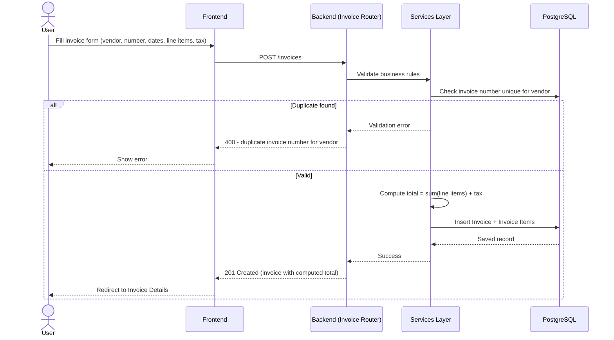
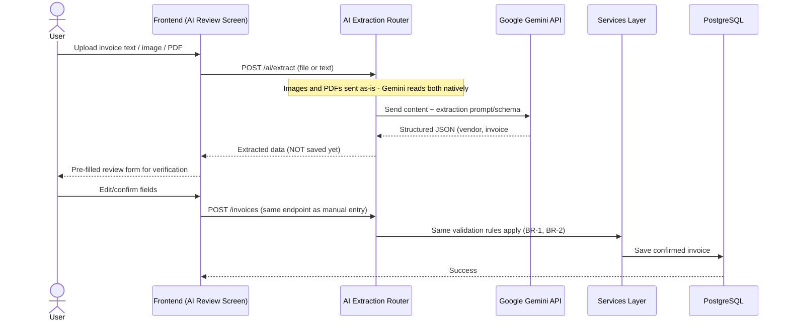
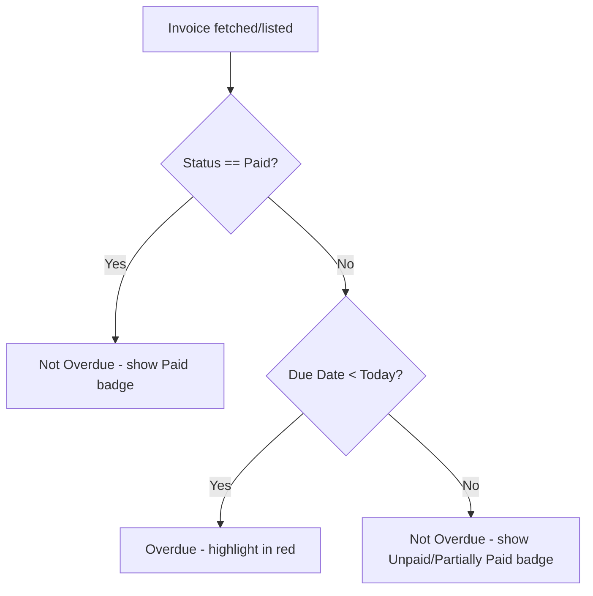

# System Architecture & Flow
## Smart Invoice Manager

### 1. High-Level Architecture

```mermaid
flowchart LR
    subgraph Client["Frontend (React + Vite + TS)"]
        UI1[Vendor List]
        UI2[Invoice List]
        UI3[Add/Edit Invoice]
        UI4[Invoice Details]
        UI5[Dashboard]
        UI6[AI Extraction/Review]
    end

    subgraph Server["Backend (FastAPI)"]
        R1[Vendor Router]
        R2[Invoice Router]
        R3[Dashboard Router]
        R4[AI Extraction Router]
        SVC[Services Layer\n(totals, overdue, uniqueness rules)]
        AI[AI Client\n(Google Gemini API)]
    end

    DB[(PostgreSQL)]

    Client -->|REST/JSON| Server
    R1 --> SVC
    R2 --> SVC
    R3 --> SVC
    R4 --> AI
    SVC --> DB
    AI -.->|extracted JSON, not auto-saved| R4
```

**Explanation:**
- The **frontend** is a React SPA with six screens matching the MVP screen list. It talks to the backend only via REST/JSON — no direct DB access.
- The **backend** is a FastAPI app split into routers (one per module: Vendor, Invoice, Dashboard, AI Extraction). All business rules (unique invoice number per vendor, total calculation, overdue detection) live in a **services layer**, not scattered across routers — this keeps the app easy to modify when the live requirement-change task hits.
- The **AI Extraction Router** is isolated from the core Invoice logic. It calls Google Gemini's API and returns structured JSON to the frontend's review screen — it **never writes to the database directly**. Only after the user confirms/edits on the review screen does the data flow through the normal Invoice creation path (same validation, same business rules).
- **PostgreSQL** is the single source of truth, accessed only through SQLAlchemy models in the services layer.

---

### 2. Core Invoice Creation Flow (Manual)



---

### 3. AI Extraction Flow



**Key point:** AI-extracted data is treated as a *draft*, not a fact. It reuses the exact same invoice-creation endpoint and validation as manual entry — this guarantees business rules (BR-1, BR-2) can never be bypassed by AI extraction, and keeps the AI module decoupled from the core domain logic.

---

### 4. Overdue Detection Flow



This is computed on read (not stored as a separate DB flag), so it's always accurate relative to "today" without needing a background job.

---

### 5. Dashboard Statistics Flow

```mermaid
flowchart LR
    DB[(PostgreSQL)] --> AGG[Dashboard Router aggregation queries]
    AGG --> S1[Total Outstanding Amount]
    AGG --> S2[Overdue Invoice Count]
    AGG --> S3[Paid vs Unpaid vs Partially Paid totals]
    AGG --> S4[Spend by Vendor]
    S1 & S2 & S3 & S4 --> UI[Dashboard UI - cards + charts]
