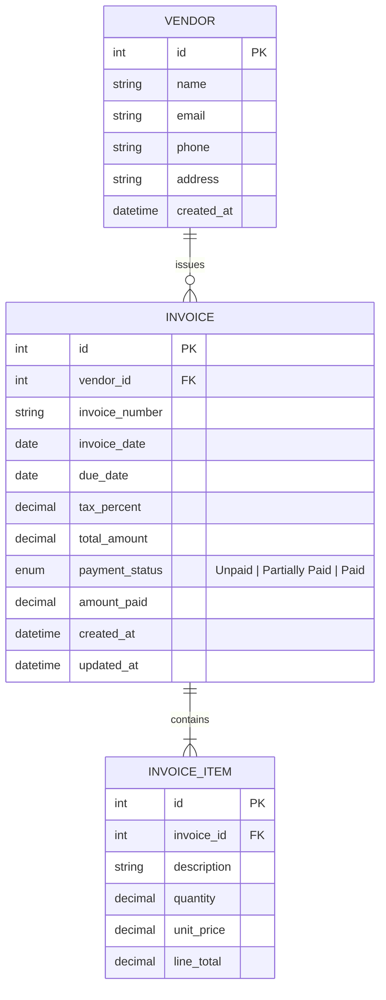

# Database Design
## Smart Invoice Manager

### 1. Entity-Relationship Diagram

---

### 2. Field-Level Notes

#### Vendor
| Field | Type | Notes |
|---|---|---|
| id | PK | |
| name | string, required | |
| email | string, optional | |
| phone | string, optional | |
| address | string, optional | |
| created_at | timestamp | |

#### Invoice
| Field | Type | Notes |
|---|---|---|
| id | PK | |
| vendor_id | FK → Vendor | required |
| invoice_number | string, required | **unique together with vendor_id** (BR-1) — enforced via composite unique constraint `(vendor_id, invoice_number)` |
| invoice_date | date, required | |
| due_date | date, required | used for overdue calculation (BR-3) |
| tax_percent | decimal, default 0 | tax rate applied to the invoice subtotal (e.g. `5` = 5%), not a flat amount |
| total_amount | decimal, computed | = subtotal + (subtotal × tax_percent / 100) (BR-2) — recalculated server-side on every save, never trusted from client |
| payment_status | enum | `unpaid`, `partially_paid`, `paid` |
| amount_paid | decimal, default 0 | supports Partially Paid tracking |
| created_at / updated_at | timestamp | |

#### Invoice Item
| Field | Type | Notes |
|---|---|---|
| id | PK | |
| invoice_id | FK → Invoice | required, cascade delete with invoice |
| description | string, required | |
| quantity | decimal, required | |
| unit_price | decimal, required | |
| line_total | decimal, computed | = quantity × unit_price |

---

### 3. Constraints Summary

| Constraint | Enforces |
|---|---|
| Unique `(vendor_id, invoice_number)` on Invoice | BR-1 — invoice number unique per vendor |
| Server-side recomputation of `total_amount` | BR-2 — total always matches line items + tax (applied as a percentage of subtotal) |
| `payment_status` enum restricted to 3 values | Consistent status vocabulary |
| Overdue = derived at query time (`due_date < now() AND payment_status != 'paid'`) | BR-3 — no stale stored flag |

---

### 4. Migration Strategy

Alembic manages schema migrations. Every schema change (including from the live requirement-change task) should be a new Alembic revision — never a manual DB edit — so the change is reproducible and reviewable.
